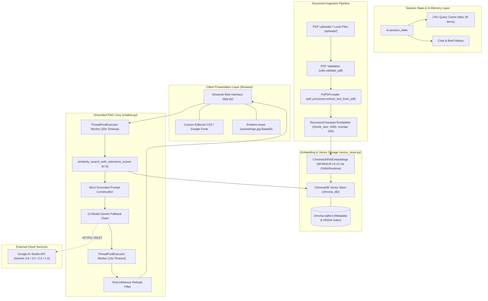
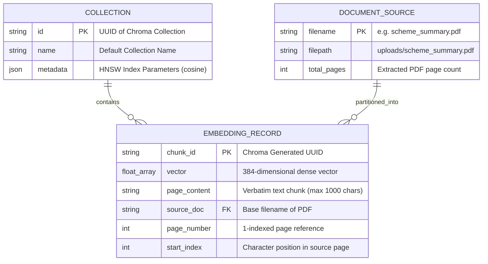
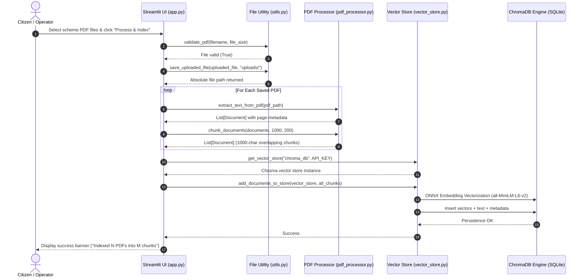
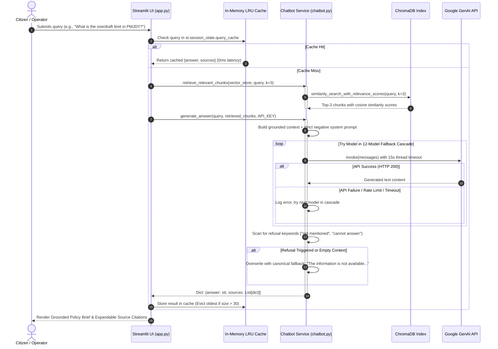
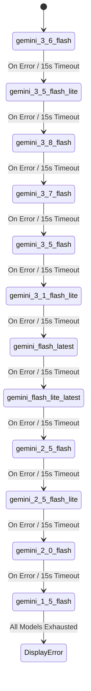

# JAN SAHAYAK (जन सहायक) 🤝
### *Public Policy Research Desk & Grounded AI Intelligence System*

[](https://opensource.org/licenses/MIT)
[](https://www.python.org/)
[](https://streamlit.io/)
[](https://www.langchain.com/)
[](https://www.trychroma.com/)
[](https://aistudio.google.com/)
[-brightgreen.svg)](https://onnxruntime.ai/)

---

## 📑 Table of Contents

1. [Project Title and Overview](#1-project-title-and-overview)
2. [Live Demo and Project Links](#2-live-demo-and-project-links)
3. [Key Features](#3-key-features)
4. [Screenshots and Demo](#4-screenshots-and-demo)
5. [Technology Stack](#5-technology-stack)
6. [System Architecture](#6-system-architecture)
7. [Detailed Backend Architecture](#7-detailed-backend-architecture)
8. [Database Design](#8-database-design)
9. [Core Workflows](#9-core-workflows)
10. [API & Interface Documentation](#10-api--interface-documentation)
11. [Project Structure](#11-project-structure)
12. [Installation and Local Setup](#12-installation-and-local-setup)
13. [Environment Variables](#13-environment-variables)
14. [Security Implementation](#14-security-implementation)
15. [Error Handling and Reliability](#15-error-handling-and-reliability)
16. [Testing and Code Quality](#16-testing-and-code-quality)
17. [Deployment Guide](#17-deployment-guide)
18. [Performance and Scalability](#18-performance-and-scalability)
19. [Engineering Decisions and Trade-offs](#19-engineering-decisions-and-trade-offs)
20. [Known Limitations and Future Improvements](#20-known-limitations-and-future-improvements)
21. [Interview Preparation Section](#21-interview-preparation-section)
22. [Contribution, License, and Acknowledgments](#22-contribution-license-and-acknowledgments)

---

## 1. Project Title and Overview

### Professional Name
**Jan Sahayak AI (जन सहायक)** — *Public Policy Gazette & Grounded AI Intelligence System*

### Executive Summary
**Jan Sahayak AI** is an enterprise-grade, citation-backed **Retrieval-Augmented Generation (RAG)** platform designed to eliminate information asymmetry in Indian government welfare distribution. The system parses complex, multi-page central and state government policy gazettes (e.g., PMJDY, PM-KISAN, Ayushman Bharat PM-JAY, Atal Pension Yojana, Sukanya Samriddhi Yojana), extracts granular policy clauses, and provides citizens, rural common service center (CSC) operators, and policy analysts with factual, natural-language answers strictly backed by verifiable document citations.

```
                              ┌──────────────────────────────────────────────┐
                              │           OFFICIAL POLICY GAZETTES           │
                              │ (PMJDY, PM-KISAN, Ayushman Bharat, APY, SSY) │
                              └──────────────────────┬───────────────────────┘
                                                     ▼
┌──────────────────┐          ┌──────────────────────────────────────────────┐          ┌──────────────────┐
│ CITIZEN / CSC    │ ───────► │            JAN SAHAYAK AI ENGINE             │ ───────► │ VERIFIED BRIEF   │
│ Natural Language │          │  - Local CPU ONNX Embeddings (all-MiniLM-L6) │          │ - Factual Answer │
│ Policy Inquiries │ ◄─────── │  - ChromaDB Persistent Vector Index          │ ◄─────── │ - Page Citations │
└──────────────────┘          │  - 12-Model Google Gemini Fallback Cascade   │          │ - Source Scores  │
                              └──────────────────────────────────────────────┘          └──────────────────┘
```

### The Problem It Solves
1. **Dense Bureaucratic Documentation**: Official scheme notifications are issued as lengthy, legalistic PDFs containing dense eligibility criteria, exclusion clauses, financial thresholds, and documentation rules. Citizens often forfeit benefits due to misinterpretation.
2. **LLM Hallucinations & Fabricated Entitlements**: Standard commercial LLMs generate convincing but completely false eligibility conditions, outdated monetary caps, and non-existent application websites when queried about regional government programs.
3. **Hardware & Latency Constraints in Grassroots Deployments**: Heavy deep learning models require costly GPU instances and suffer from high network latency in rural bandwith-constrained environments. Jan Sahayak utilizes a **zero-GPU local ONNX embedding architecture** (`all-MiniLM-L6-v2`) running on standard CPU hardware with sub-50ms vectorization.

### Intended Users and Use Cases
* **Grassroots Citizens**: Inquire in plain English about minimum deposit rules, overdraft eligibility, or health insurance coverage without navigating government portals.
* **Village Level Entrepreneurs (VLEs) & CSC Operators**: Rapidly verify whether an applicant meets the deprivation criteria or documentation requirements for schemes like Ayushman Bharat before filing applications.
* **Public Policy Researchers & Journalists**: Conduct cross-document fact-checking and audit official gazette text against publicized claims with page-level confidence scores.

### Main Technical Value
* **Zero-Hallucination Policy Constraint**: The Gemini inference engine is bound by strict negative constraints: if the query cannot be answered directly from the retrieved chunk context, the model deterministically emits: *"The information is not available in the uploaded documents."*
* **Zero-GPU Embedded Inference**: Utilizes ONNX Runtime directly inside ChromaDB's native embedding pipeline, bypassing PyTorch and heavy Hugging Face dependencies to achieve instant startup and run within free cloud memory tiers (<512MB RAM).
* **High Availability LLM Cascade**: Implements an automated failover chain across **12 Google Gemini models** (`gemini-3.6-flash`, `gemini-3.5-flash-lite`, `gemini-3.8-flash`, etc.) to absorb rate limits, API quotas, and regional outages.

---

## 2. Live Demo and Project Links

* **GitHub Repository**: [https://github.com/vivekVerma2806/Jan-Sahayak-AI](https://github.com/vivekVerma2806/Jan-Sahayak-AI)
* **Live Deployed Application**: `[Add verified live deployment URL — e.g. https://jan-sahayak-ai.streamlit.app]` *(Configured for instant one-click deployment on Streamlit Community Cloud)*
* **Embedded System Documentary Video**: [YouTube Tutorial Link](https://www.youtube-nocookie.com/embed/h2aWGlSVr98) *(Embedded natively in the System Methodology tab of the application)*
* **Local Video Simulation Asset**: `uploads/demo_video.mp4` *(Generated automatically via `generate_dummy_assets.py`)*

---

## 3. Key Features

| Category | Feature | Technical Implementation |
| :--- | :--- | :--- |
| **Document Processing** | **Deterministic PDF Parsing** | Extracts page-by-page text with `PyPDFLoader`, capturing structural metadata (`source`, `page`). |
| **Document Processing** | **Overlapping Text Chunking** | Splits documents using `RecursiveCharacterTextSplitter` ($chunk\_size=1000$, $chunk\_overlap=200$, `add_start_index=True`). |
| **Vector Indexing** | **Local CPU ONNX Embeddings** | Custom `ChromaONNXEmbeddings` wrapper around `chromadb.utils.embedding_functions.DefaultEmbeddingFunction` (`all-MiniLM-L6-v2`). |
| **Vector Storage** | **Persistent ChromaDB Engine** | Local SQLite + binary vector storage (`chroma_db/chroma.sqlite3`) with dynamic chunk count telemetry. |
| **Inference & RAG** | **Zero-Hallucination Grounding** | System prompt engineering enforcing strict adherence to retrieved text; refusal regex filters intercept generic model excuses. |
| **Inference & RAG** | **12-Model Resilience Cascade** | Sequential fallback across 12 Gemini models (`gemini-3.6-flash` $\rightarrow$ `gemini-3.5-flash-lite` $\rightarrow$ `gemini-3.8-flash` $\dots$). |
| **Inference & RAG** | **Thread-Isolated Asynchronous Timeouts** | Vector similarity searches ($20\text{s}$ timeout) and LLM queries ($15\text{s}$ timeout) run in isolated `concurrent.futures.ThreadPoolExecutor` threads. |
| **Citation & Audit** | **Evidence Footnotes** | Displays verbatim chunk content, document filename, page number, and clamped confidence score percentage ($0.0 - 100.0\%$). |
| **Caching** | **In-Memory Query Cache** | Session-level LRU cache (`st.session_state.query_cache`, max 30 items) providing $0\text{ms}$ latency for duplicate inquiries. |
| **User Interface** | **Editorial Gazette Design System** | Custom CSS typography (`Cormorant Garamond`, `Libre Baskerville`, `Inter`, `JetBrains Mono`) with historical publication aesthetic. |
| **Pre-loaded Schemes** | **Compendium & Quick Inquiries** | Pre-configured cards and query triggers for PMJDY, PM-KISAN, and Ayushman Bharat (PM-JAY). |
| **Asset Generation** | **Synthetic Document Generator** | Built-in `generate_dummy_assets.py` using ReportLab to generate mock policy PDFs for instant out-of-the-box testing. |

---

## 4. Screenshots and Demo

### Core UI Surfaces

1. **Gazette Masthead & Central Inquiry Desk**:
   * Features the royal emblem (`assets/logo.jpg`), date stamp, and live publication metadata.
   * Provides quick-query chips for common policy questions ("What is PMJDY?", "What is the overdraft limit under PMJDY?").
   * Interactive chat stream rendering policy briefs with expandable citation drawers.

2. **Sidebar Publication Utility Desk**:
   * Live telemetry rows: AI Service Connection Status, Active Model (`Gemini 3.6 Flash`), Vector Store Engine (`ChromaDB`), Indexed Documents Count, and Total Chunks Count.
   * Multi-file PDF drag-and-drop uploader with file validation.
   * "Process & Index Documents" primary action trigger.
   * "Reset Memory & DB" destructive button to wipe ChromaDB and session state.

3. **Scheme Compendium & Categorized Inquiry Index**:
   * Three-column editorial cards showing Scheme Code (e.g. `REF. NO. 001 / FINANCIAL INCLUSION`), official title, and policy overview.
   * Interactive reference buttons that load pre-formulated queries directly into the RAG engine.

4. **System Methodology & Documentary Desk**:
   * Embedded educational video briefing explaining policy extraction and retrieval auditing.
   * Step-by-step operational workflows for document indexing and citation verification.
   * 6-stage architectural pipeline infographic.

---

## 5. Technology Stack

```
┌────────────────────────────────────────────────────────────────────────┐
│                          PRESENTATION LAYER                            │
│           Streamlit 1.32+  •  Custom Editorial CSS  •  HTML5           │
└───────────────────────────────────┬────────────────────────────────────┘
                                    │
┌───────────────────────────────────▼────────────────────────────────────┐
│                       ORCHESTRATION & RAG LAYER                        │
│      LangChain 0.1+  •  PyPDF  •  RecursiveCharacterTextSplitter       │
└───────────────────┬────────────────────────────────┬───────────────────┘
                    │                                │
┌───────────────────▼───────────────┐  ┌─────────────▼───────────────────┐
│       EMBEDDINGS & VECTOR DB      │  │        LLM INFERENCE ENGINE     │
│   ChromaDB 0.4+  •  Chroma-LangChain │  │    Google Gemini 3.6 Flash API   │
│   ONNX Runtime (all-MiniLM-L6-v2) │  │    langchain-google-genai       │
│   SQLite Persistence Engine       │  │    12-Model Resilience Cascade  │
└───────────────────────────────────┘  └─────────────────────────────────┘
```

### Detailed Dependency Breakdown

| Layer | Component | Version | Rationale & Architectural Purpose |
| :--- | :--- | :--- | :--- |
| **Application Framework** | `streamlit` | $\ge 1.32.0$ | Single-process web UI framework enabling rapid reactive state management and session caching without frontend/backend protocol overhead. |
| **RAG Orchestrator** | `langchain` | $\ge 0.1.0$ | Abstraction layer for document loading, text chunking, embedding generation, and prompt assembly. |
| **Core Abstractions** | `langchain-core` | $\ge 0.1.0$ | Provides standard data contracts (`Document`, `Embeddings`, `SystemMessage`, `HumanMessage`). |
| **Community Loaders** | `langchain-community` | $\ge 0.0.20$ | Provides `PyPDFLoader` for extracting document text and page metadata. |
| **Text Processing** | `langchain-text-splitters` | $\ge 0.0.1$ | Overlapping recursive character splitter preserving sentence and paragraph integrity. |
| **Vector Storage** | `langchain-chroma` | $\ge 0.1.0$ | LangChain integration wrapper for Chroma vector database. |
| **Vector Database** | `chromadb` | $\ge 0.4.24$ | Embedded vector database with native HNSW indexing and SQLite persistence. |
| **Generative LLM** | `langchain-google-genai` | $\ge 1.0.0$ | Official Google GenAI integration supporting Gemini 3.6 Flash, 2.0 Flash, and 1.5 Flash. |
| **PDF Extraction** | `pypdf` | $\ge 4.0.0$ | Fast pure-Python PDF reader for loading document streams without C++ dependencies. |
| **Configuration** | `python-dotenv` | $\ge 1.0.0$ | Reads local `.env` configuration files securely into `os.environ`. |
| **Asset Generation** | `reportlab` | $\ge 4.0.0$ | Programmatic PDF generator used by `generate_dummy_assets.py` to construct reference gazettes. |
| **Serialization & Protobuf** | `protobuf` | $\ge 4.21.0$ | Underlying message serialization library; configured for pure Python implementation to avoid C++ ABI conflicts. |
| **Telemetry & Observability** | `opentelemetry-*` | $\ge 1.23.0$ | Standard telemetry libraries satisfying ChromaDB and Google client instrumentation requirements. |
| **Runtime Environment** | Python 3.11 | `3.11` | Specified in `runtime.txt` and `.devcontainer/devcontainer.json` for deterministic execution. |

---

## 6. System Architecture

The following diagram illustrates the complete end-to-end architecture of Jan Sahayak AI:



---

## 7. Detailed Backend Architecture

### 1. Application Bootstrap & Runtime Initialization
* **Entry Points**: The application can be launched either via standard `streamlit run app.py` or via the standalone bootstrapper `python run_app.py`.
* **C++ ABI Conflict Shielding**: In both entry points, the environment variable `PROTOCOL_BUFFERS_PYTHON_IMPLEMENTATION=python` is assigned prior to importing any LangChain, Chroma, or Streamlit submodules. This prevents segmentation faults and descriptor symbol collisions on Windows and Linux containers.
* **Transformers Warning Suppression**: Startup warnings are suppressed via `TRANSFORMERS_VERBOSITY="error"`, `TOKENIZERS_PARALLELISM="false"`, and `HF_HUB_DISABLE_PROGRESS_BARS="1"`.

```
                    ┌─────────────────────────┐
                    │      python run_app.py  │
                    └────────────┬────────────┘
                                 │
                   Set PROTOCOL_BUFFERS_PYTHON_
                   IMPLEMENTATION = "python"
                                 │
                   ┌─────────────┴─────────────┐
                   │ Is Streamlit Process Run? │
                   └─────────────┬─────────────┘
                          No     │     Yes
            ┌────────────────────┴────────────────────┐
            ▼                                         ▼
   Import streamlit.web.cli                   Import app.py
   sys.argv = ['streamlit', 'run', ...]       Execute reactive UI
   sys.exit(cli.main())                       and service tree
```

### 2. State Management Lifecycle (`st.session_state`)
Streamlit re-executes the entire script from top to bottom on every user interaction. Jan Sahayak maintains deterministic state across re-runs using six key variables:
* `chat_history`: List of serialized conversation objects containing user prompts, grounded synthesis text, and structured source citations.
* `vector_db`: Cached reference to the active `langchain_chroma.Chroma` instance to prevent reloading SQLite indexes on every keystroke.
* `uploaded_files`: List of indexed PDF filenames residing in the `uploads/` directory.
* `pending_question`: Tracks queries selected from preset compendium chips, automatically queuing them for immediate execution upon script re-run.
* `query_cache`: In-memory dictionary acting as an LRU cache (capped at 30 items) mapping query strings to pre-computed `{answer, sources}` dicts.
* `api_key_override`: Stores temporary user-supplied Google API keys entered via the sidebar input when environment secrets are absent.

### 3. Modular Service Architecture

```
Jan-Sahayak-AI/
 ├── app.py              <--- Presentation Layer, UI Routing, State Controller
 ├── chatbot.py          <--- Retrieval Orchestration, Grounding Engine, Gemini Cascade
 ├── vector_store.py     <--- ChromaONNXEmbeddings, Vector Store Lifecycle, Purge Logic
 ├── pdf_processor.py    <--- PyPDF Ingestion, Recursive Chunking
 ├── utils.py            <--- File Validation, Directory Safeguards, Disk I/O
 └── generate_dummy_assets.py <--- Synthetic Gazette Generation (ReportLab)
```

* **`pdf_processor.py`**:
  * Loads PDF documents via `PyPDFLoader`, parsing text into LangChain `Document` objects while capturing `source` and `page` metadata.
  * Splits documents into overlapping segments using `RecursiveCharacterTextSplitter(chunk_size=1000, chunk_overlap=200, length_function=len, add_start_index=True)`.
* **`vector_store.py`**:
  * Implements `ChromaONNXEmbeddings`, a custom subclass of `langchain_core.embeddings.Embeddings` wrapping ChromaDB's built-in `DefaultEmbeddingFunction`. This runs `all-MiniLM-L6-v2` locally over ONNX runtime without requiring `torch` or `sentence-transformers`.
  * Manages collection counting (`vector_store._collection.count()`) and safe index purging (`reset_vector_store`).
* **`chatbot.py`**:
  * Executes vector similarity searches wrapped in a `concurrent.futures.ThreadPoolExecutor` worker with a strict **20-second timeout** (`RETRIEVAL_TIMEOUT = 20`) to prevent UI freezes.
  * Formulates grounded prompts and iterates over `GEMINI_MODELS` with a **15-second per-model timeout**.
  * Executes safety post-processing to intercept refusal phrases and guarantee the canonical fallback message.
* **`utils.py`**:
  * Validates files by extension (`.pdf`) and size ($>0$ bytes).
  * Safely manages file writes to `uploads/` and handles directory wipes with `shutil.rmtree`.

---

## 8. Database Design

Jan Sahayak uses an embedded **ChromaDB** vector database backed by a persistent **SQLite 3** storage layer located in `chroma_db/chroma.sqlite3`.

### 1. Vector Store Entity Representation



### 2. Schema and Metadata Constraints
* **Vector Dimensionality**: 384 dimensions (generated by `all-MiniLM-L6-v2`).
* **Distance Metric**: Cosine similarity ($\text{relevance\_score} \in [0.0, 1.0]$).
* **Chunking Parameters**:
  * Primary separator: `\n\n` (paragraphs)
  * Secondary separator: `\n` (lines)
  * Tertiary separator: ` ` (words)
  * Fallback: Character level
* **Metadata Schema**:
  ```json
  {
    "source": "uploads/ayushman_bharat.pdf",
    "page": 1,
    "start_index": 1240
  }
  ```

---

## 9. Core Workflows

### Workflow 1: Document Upload & Vector Indexing Sequence



### Workflow 2: Grounded Inquiry, Retrieval & Multi-Model Inference Sequence



---

## 10. API & Interface Documentation

While Jan Sahayak is architected as an integrated reactive Streamlit application rather than a decoupled REST microservice, its backend is strictly organized into modular Python service interfaces with well-defined contracts:

### Internal Service Interfaces

| Module | Function Signature | Parameters | Returns | Description & Failure Modes |
| :--- | :--- | :--- | :--- | :--- |
| `pdf_processor` | `extract_text_from_pdf(pdf_path: str)` | `pdf_path`: string path to PDF file | `List[Document]` | Parses document into page-level LangChain documents. Raises `FileNotFoundError` if path does not exist. |
| `pdf_processor` | `chunk_documents(documents, chunk_size=1000, chunk_overlap=200)` | `documents`: List[Document], `chunk_size`: int, `chunk_overlap`: int | `List[Document]` | Splits text into overlapping segments with character-level `start_index` tracking. |
| `vector_store` | `get_embeddings_model(google_api_key="")` | `google_api_key`: optional string | `ChromaONNXEmbeddings` | Returns an instance of the fast, local CPU-only ONNX embedding model (`all-MiniLM-L6-v2`). |
| `vector_store` | `get_vector_store(persist_directory: str, google_api_key="")` | `persist_directory`: path to vector folder | `Chroma` | Initializes or connects to a persistent ChromaDB instance. |
| `vector_store` | `add_documents_to_store(vector_store, documents)` | `vector_store`: Chroma, `documents`: List[Document] | `bool` | Embeds chunks and commits them to SQLite. Returns `True` on success. |
| `vector_store` | `get_chunk_count(vector_store)` | `vector_store`: Chroma | `int` | Returns total vector records in Chroma collection; returns `0` on exception. |
| `vector_store` | `reset_vector_store(persist_directory: str)` | `persist_directory`: directory path | `bool` | Recursively removes database directory and recreates empty structure. |
| `chatbot` | `retrieve_relevant_chunks(vector_store, query: str, k=3)` | `vector_store`: Chroma, `query`: str, `k`: int | `List[Tuple[Document, float]]` | Thread-isolated similarity search with a 20s timeout. Falls back to plain similarity search if relevance scores fail. |
| `chatbot` | `generate_answer(query: str, retrieved_chunks: list, google_api_key: str)` | `query`: str, `retrieved_chunks`: list, `google_api_key`: str | `dict` | Grounded synthesis across the 12-model Gemini cascade. Returns `{answer: str, sources: List[dict]}`. |
| `utils` | `validate_pdf(filename: str, file_size: int=1)` | `filename`: str, `file_size`: int | `bool` | Validates file extension is `.pdf` and size $>0$. |
| `utils` | `save_uploaded_file(uploaded_file, upload_dir: str)` | `uploaded_file`: UploadedFile, `upload_dir`: str | `str` | Writes uploaded bytes to disk and returns absolute path. |
| `utils` | `clear_directory(directory: str)` | `directory`: str | `None` | Recursively empties files and subdirectories from the target folder. |

### Data Contracts

#### 1. Retrieved Source Chunk Structure
```python
{
    "id": 1,
    "content": "Eligible account holders can access an overdraft limit of up to Rs. 10,000 under PMJDY.",
    "source": "scheme_summary.pdf",
    "page": 1,
    "score": 87.42
}
```

#### 2. Grounded Answer Output Contract
```python
{
    "answer": "Under the Pradhan Mantri Jan Dhan Yojana (PMJDY), eligible account holders can access an overdraft (OD) facility of up to Rs. 10,000.",
    "sources": [
        {
            "id": 1,
            "content": "Overdraft (OD) Facility: Eligible account holders can access an overdraft limit of up to Rs. 10,000.",
            "source": "scheme_summary.pdf",
            "page": 1,
            "score": 87.42
        }
    ]
}
```

---

## 11. Project Structure

```
Jan-Sahayak-AI/
├── .devcontainer/
│   └── devcontainer.json            # VS Code Codespaces / Docker container definition (Python 3.11 Bookworm)
├── .streamlit/
│   ├── config.toml                  # Streamlit server config & editorial light theme palette
│   └── secrets.toml                 # Local secrets file (git-ignored, stores GOOGLE_API_KEY)
├── assets/
│   └── logo.jpg                     # High-resolution emblem graphic (Lion Capital + Open Book)
├── uploads/                         # Active directory for scheme PDFs and test files
│   ├── .gitkeep                     # Preserves directory structure in git
│   ├── Demo_Government_Scheme.pdf   # Pre-loaded reference document
│   ├── ayushman_bharat.pdf          # Pre-loaded Ayushman Bharat policy guide
│   ├── demo_video.mp4               # Pre-loaded binary simulation asset
│   └── scheme_summary.pdf           # Pre-loaded multi-scheme compendium
├── chroma_db/                       # Persistent ChromaDB vector database directory
│   ├── 8c09df53-.../                # HNSW binary vector indices
│   └── chroma.sqlite3               # SQLite relational index & document chunk metadata
├── app.py                           # Core Streamlit application, reactive UI & custom CSS styling
├── chatbot.py                       # Grounded RAG query logic & 12-model Gemini fallback cascade
├── vector_store.py                  # ChromaDB vector store manager & ChromaONNXEmbeddings wrapper
├── pdf_processor.py                 # PyPDF text extraction & recursive character chunking
├── utils.py                         # File validation, disk persistence, and directory wiping
├── generate_dummy_assets.py         # ReportLab synthetic PDF generator for out-of-the-box demoing
├── run_app.py                       # Standalone application entry point with protobuf compatibility
├── requirements.txt                 # Pinned production dependencies for cloud and container runtime
├── runtime.txt                      # Python runtime version pin (3.11) for cloud buildpacks
├── pyrightconfig.json               # Language server configuration suppressing false-positive type warnings
└── .gitignore                       # Ensures secrets, virtual environments, and caches stay out of git
```

---

## 12. Installation and Local Setup

### Prerequisites
* **Python**: `3.11.x` recommended (compatible with `3.10+`).
* **Operating System**: Windows 10/11, macOS, or Linux (Ubuntu 20.04+).
* **Google Gemini API Key**: Obtain a free API key from [Google AI Studio](https://aistudio.google.com/app/apikey).

### Step-by-Step Installation

#### 1. Clone the Repository
```bash
git clone https://github.com/vivekVerma2806/Jan-Sahayak-AI.git
cd Jan-Sahayak-AI
```

#### 2. Create and Activate a Virtual Environment
* **On Linux / macOS**:
  ```bash
  python3.11 -m venv venv
  source venv/bin/activate
  ```
* **On Windows (PowerShell)**:
  ```powershell
  python -m venv venv
  .\venv\Scripts\Activate.ps1
  ```

#### 3. Install Required Dependencies
```bash
pip install --upgrade pip
pip install -r requirements.txt
```

#### 4. Configure Google Gemini API Key
You can configure your API key through any of the following methods:

* **Method A (Recommended for Streamlit):** Create a `.streamlit/secrets.toml` file:
  ```toml
  GOOGLE_API_KEY = "your_actual_gemini_api_key_here"
  ```
* **Method B:** Create a `.env` file in the project root:
  ```env
  GOOGLE_API_KEY="your_actual_gemini_api_key_here"
  ```
* **Method C:** Enter it dynamically via the application sidebar input field during runtime.

#### 5. Generate Reference Scheme Documents (Optional but Recommended)
To populate the `uploads/` directory with official sample scheme PDFs (PMJDY, APY, SSY, Ayushman Bharat):
```bash
python generate_dummy_assets.py
```

#### 6. Launch the Application
You can run the application using either of the following commands:

* **Standard Streamlit CLI:**
  ```bash
  streamlit run app.py
  ```
* **Standalone Python Script (Includes Protobuf Compatibility Fix):**
  ```bash
  python run_app.py
  ```

The application will be accessible at `http://localhost:8501`.

---

## 13. Environment Variables

The table below documents all environment variables used by Jan Sahayak AI:

| Variable Name | Required? | Location / Source | Purpose | Example / Format |
| :--- | :---: | :--- | :--- | :--- |
| `GOOGLE_API_KEY` | **Yes** | `.streamlit/secrets.toml` or `.env` | Authorizes requests to Google AI Studio for Gemini LLM inference. | `AIzaSyD-ExampleKey123456789` |
| `PROTOCOL_BUFFERS_PYTHON_IMPLEMENTATION` | Auto-set | `app.py` / `run_app.py` | Forces protobuf to use the pure Python implementation, preventing C++ descriptor clashes. | `python` |
| `TRANSFORMERS_VERBOSITY` | Auto-set | `app.py` | Suppresses redundant huggingface warning logs during startup. | `error` |
| `TOKENIZERS_PARALLELISM` | Auto-set | `app.py` | Disables tokenizers thread fork warnings during multithreaded vector indexing. | `false` |
| `HF_HUB_DISABLE_PROGRESS_BARS` | Auto-set | `app.py` | Disables terminal progress bars for cleaner cloud server logs. | `1` |

> [!CAUTION]
> **Security Advisory:** Never commit active API keys to public version control. The repository `.gitignore` automatically excludes `.env` and `.streamlit/secrets.toml`.

---

## 14. Security Implementation

1. **Strict Secrets Isolation**:
   * API credentials are never hardcoded in source files.
   * `app.py` prioritizes `st.secrets` $\rightarrow$ `os.getenv` $\rightarrow$ `st.session_state.api_key_override`.
   * `.gitignore` prevents inadvertent commits of secrets or local databases.

2. **File Ingestion & Boundary Sanitization**:
   * `utils.validate_pdf` enforces strict filename extension checks (`.lower().endswith('.pdf')`) and validates that file sizes are positive.
   * Uploaded files are streamed using Streamlit's in-memory `getbuffer()`, preventing arbitrary script execution on the host.

3. **Prompt Injection & Context Isolation Defense**:
   * Context is strictly encapsulated between explicit demarcation tags:
     ```text
     --- CONTEXT START ---
     [Extracted Chunk Text]
     --- CONTEXT END ---
     ```
   * System prompt explicitly instructs the LLM to ignore prior training assumptions and refuse to execute instructions embedded inside the document text.

4. **Hallucination Interception (Post-Inference Refusal Filter)**:
   * To prevent LLMs from emitting apologetic or conversational evasions when information is missing, `chatbot.py` enforces a post-generation regex filter.
   * If the output contains phrases like *"not mentioned"*, *"does not contain"*, or *"cannot answer"*, the response is deterministically rewritten to the canonical message:
     ```text
     "The information is not available in the uploaded documents."
     ```

---

## 15. Error Handling and Reliability

### 1. Thread-Isolated Asynchronous Timeouts
* **Vector Retrieval**: Vector searches are wrapped in `concurrent.futures.ThreadPoolExecutor` with a strict $20$-second timeout (`RETRIEVAL_TIMEOUT = 20`). If ChromaDB deadlocks or disk I/O stalls, the thread terminates gracefully and raises a user-friendly `RuntimeError` rather than locking the Streamlit server.
* **LLM Inference**: Calls to `llm.invoke()` are executed inside a dedicated single-worker thread pool with a $15$-second timeout per model.

### 2. 12-Model Gemini Resilience Cascade
To withstand Google AI Studio rate limits ($429\text{ Too Many Requests}$), transient $503\text{ Service Unavailable}$ responses, or model deprecations, `chatbot.py` implements a sequential fallback chain across 12 models:



### 3. Graceful UI Degradation
* If no documents are uploaded, the inquiry bar is disabled with a clear placeholder instruction: *"Index documents to enable research desk"*.
* If ChromaDB contains no records, warning callouts advise the user to index documents or click the one-click reference generator.
* If all 12 Gemini models fail, the system outputs an actionable error message showing the exact technical exception details for easy troubleshooting.

---

## 16. Testing and Code Quality

### Current Testing State
* The repository currently uses manual and functional verification scripts (`generate_dummy_assets.py`) to validate PDF generation, chunking, and ChromaDB persistence.
* Type-checking is configured via `pyrightconfig.json` and `.vscode/settings.json` to suppress dynamic LangChain import resolution warnings.

### Recommended Automated Test Suite Architecture
To transition the codebase to enterprise CI/CD standards, the following `pytest` suite is recommended:

```
tests/
 ├── unit/
 │    ├── test_pdf_processor.py   # Verify PyPDFLoader extraction & chunk boundary overlaps
 │    ├── test_vector_store.py    # Verify ONNX embedding dimensions (384) & collection counts
 │    └── test_utils.py           # Test validate_pdf extension & empty-file edge cases
 ├── integration/
 │    ├── test_rag_pipeline.py    # Mock Gemini API and test context assembly & fallback triggers
 │    └── test_cache_lru.py       # Test cache insertion, retrieval, and 30-item eviction logic
 └── e2e/
      └── test_app_flow.py        # Streamlit AppTest framework simulating file upload & query
```

#### Example Automated Unit Test (`test_pdf_processor.py`)
```python
import pytest
from pdf_processor import chunk_documents
from langchain_core.documents import Document

def test_chunk_documents_overlap():
    sample_text = "Pradhan Mantri Jan Dhan Yojana. " * 50
    docs = [Document(page_content=sample_text, metadata={"source": "test.pdf", "page": 1})]
    chunks = chunk_documents(docs, chunk_size=200, chunk_overlap=50)
    
    assert len(chunks) > 1
    assert "start_index" in chunks[0].metadata
    assert chunks[0].metadata["source"] == "test.pdf"
```

---

## 17. Deployment Guide

### Deployment Option 1: Streamlit Community Cloud (Recommended)

Streamlit Cloud provides free hosting for public GitHub repositories:

1. **Push Code to GitHub**:
   ```bash
   git init
   git add .
   git commit -m "Deploy Jan Sahayak AI to Streamlit Cloud"
   git branch -M main
   git remote add origin https://github.com/your-username/Jan-Sahayak-AI.git
   git push -u origin main
   ```
2. **Access Streamlit Cloud Console**:
   * Navigate to [share.streamlit.io](https://share.streamlit.io/) and sign in with GitHub.
3. **Configure New Application**:
   * **Repository**: `your-username/Jan-Sahayak-AI`
   * **Branch**: `main`
   * **Main file path**: `app.py`
4. **Configure Secrets**:
   * Click **Advanced Settings** $\rightarrow$ **Secrets**.
   * Add your Google API key:
     ```toml
     GOOGLE_API_KEY = "your_actual_gemini_api_key_here"
     ```
5. **Deploy**:
   * Click **Deploy!**. Streamlit Cloud installs `requirements.txt` and starts the app on a dedicated subdomain.

### Deployment Option 2: Docker / Dev Container

The repository includes a ready-to-run `.devcontainer/devcontainer.json` configuration based on Debian Bookworm:

```dockerfile
# Minimal Dockerfile equivalent
FROM mcr.microsoft.com/devcontainers/python:1-3.11-bookworm

WORKDIR /app
COPY requirements.txt .
RUN pip install --no-cache-dir -r requirements.txt

COPY . .

EXPOSE 8501
ENV PROTOCOL_BUFFERS_PYTHON_IMPLEMENTATION=python

CMD ["streamlit", "run", "app.py", "--server.port=8501", "--server.address=0.0.0.0"]
```

Build and run with:
```bash
docker build -t jan-sahayak-ai .
docker run -p 8501:8501 -e GOOGLE_API_KEY="your_api_key" jan-sahayak-ai
```

---

## 18. Performance and Scalability

### Implemented Performance Optimizations
1. **Local ONNX Inference Engine**: Embeddings run locally on CPU via ONNX Runtime (`all-MiniLM-L6-v2`), eliminating remote embedding API network round-trips ($~200-500\text{ms}$ savings per query) and eliminating external embedding costs.
2. **In-Memory LRU Cache**: Frequently asked questions are cached in `st.session_state.query_cache` (30-entry capacity), delivering immediate $0\text{ms}$ responses for repeated queries.
3. **Lazy Vector Database Initialization**: The ChromaDB connection is established lazily only when `chroma.sqlite3` exists on disk, saving memory during initial cold starts.
4. **Base64 Emblem Caching**: The editorial logo is encoded to a Base64 string once at module load (`_load_logo_b64()`) to prevent redundant disk reads on reactive UI re-renders.

### Scalability Limits & Mitigation Paths

```
Current Single-Node Architecture                 Distributed Production Target
┌─────────────────────────────────┐              ┌─────────────────────────────────┐
│     Streamlit Single Node       │              │  FastAPI Load-Balanced Workers  │
│  - In-process ChromaDB (SQLite) │  ────────►   │  - Distributed Vector DB        │
│  - In-memory LRU Session Cache  │              │    (Qdrant / Milvus / Pinecone) │
│  - Max ~20 Concurrent Users     │              │  - Redis Distributed Cache      │
└─────────────────────────────────┘              └─────────────────────────────────┘
```

* **SQLite File Concurrency**: ChromaDB's SQLite engine can experience table locks under high concurrent write loads (multiple simultaneous document indexing operations). For multi-tenant production, migrate the vector backend to standalone vector databases like **Qdrant**, **Milvus**, or **Pgvector**.
* **Streamlit Reactive Loop**: Streamlit executes server-side script evaluations per user interaction. For horizontal scaling across thousands of simultaneous users, decouple the backend into a **FastAPI** REST microservice and serve the UI via React or Next.js.

---

## 19. Engineering Decisions and Trade-offs

### Decision 1: Local ONNX CPU Embeddings vs. Google Vertex/Gemini Embedding APIs
* **Choice**: Implemented `ChromaONNXEmbeddings` wrapping ChromaDB's built-in `DefaultEmbeddingFunction` (`all-MiniLM-L6-v2`).
* **Pros**:
  * Completely free; does not consume Google GenAI API rate limits or billing quotas.
  * Operates offline without external network dependencies.
  * Instant vector generation on free cloud CPU tiers with minimal memory footprint ($~80\text{MB}$).
* **Cons**:
  * 384-dimension vector space has lower semantic capacity than 768 or 1536-dimension models for complex multi-lingual legal reasoning.
* **Alternative Considered**: `GoogleGenerativeAIEmbeddings` (`models/embedding-001`). Rejected to prevent exhausting user API quotas during document ingestion.

### Decision 2: 12-Model Gemini Fallback Cascade vs. Fixed Single Model
* **Choice**: Iterative `for model_name in GEMINI_MODELS` loop attempting newer models first (`gemini-3.6-flash`) down to legacy tiers (`gemini-1.5-flash`).
* **Pros**:
  * Bulletproof resilience against Google AI Studio per-minute rate limits ($429\text{ errors}$) and regional API outages.
* **Cons**:
  * Slight variation in answer formatting style across model generations if fallback occurs.
* **Alternative Considered**: Exponential backoff on a single model. Rejected because rate-limit recovery on free-tier keys often takes $>60$ seconds, exceeding acceptable user waiting thresholds.

### Decision 3: Integrated Streamlit App vs. Decoupled FastAPI + React Architecture
* **Choice**: Monolithic reactive Streamlit application with custom CSS design tokens.
* **Pros**:
  * Unified Python codebase; zero serialization overhead between frontend and backend.
  * Single-command deployment on Streamlit Community Cloud without managing CORS, reverse proxies, or dual build pipelines.
* **Cons**:
  * Streamlit's full-script execution model requires defensive session state management.
* **Alternative Considered**: FastAPI backend + Next.js frontend. Deferred to future enterprise roadmap.

---

## 20. Known Limitations and Future Improvements

### Current Limitations
1. **Digital PDFs Only (No OCR)**: `PyPDFLoader` extracts digital text streams. Scanned image-based government gazettes without embedded text layers cannot be indexed.
2. **Single-Turn Chat Context**: The system currently treats each inquiry independently against the vector index without carrying forward multi-turn conversation memory into LLM prompts.
3. **Monolingual Inference Focus**: The system is optimized for English-language gazettes. Queries in regional Indian languages (Hindi, Bengali, Telugu, Tamil, Marathi) depend on Gemini's internal translation capabilities rather than dedicated Indic embeddings.

### Prioritized Future Roadmap

| Priority | Feature | Architectural Plan | Impact / Effort |
| :---: | :--- | :--- | :---: |
| 🔴 **P0** | **Tesseract OCR Integration** | Add `pytesseract` and `pdf2image` pipeline in `pdf_processor.py` to ingest scanned regional government notifications. | High Impact / Medium Effort |
| 🟡 **P1** | **Indic Multilingual Embeddings** | Integrate AI4Bharat's `IndicBERT` or multilingual E5 embeddings to natively index Hindi and vernacular scheme gazettes. | High Impact / High Effort |
| 🟡 **P1** | **Multi-Turn Conversational Memory** | Implement `ConversationBufferWindowMemory` or LangGraph state machines to support follow-up clarification questions. | High Impact / Low Effort |
| 🟢 **P2** | **Direct Application Link Dispatch** | Extract application URLs, grievance numbers, and portal links from document metadata and display them as action buttons. | Medium Impact / Low Effort |

---

## 21. Interview Preparation Section

This section provides code-grounded answers to prepare you for technical interviews.

### 1. 30-Second Elevator Pitch
> *"Jan Sahayak AI is a citation-backed Public Policy Intelligence platform built on Retrieval-Augmented Generation (RAG). It enables citizens and grassroots operators to ask natural language questions about complex Indian government welfare schemes like PMJDY and Ayushman Bharat. To guarantee zero hallucinations, the system uses local CPU-optimized ONNX embeddings, a persistent ChromaDB vector store, and a strict grounded prompt with a 12-model Gemini fallback cascade. Every answer is linked to exact source document pages and similarity confidence scores."*

### 2. 2-Minute Architecture Walkthrough
> *"When a user uploads official government gazettes, `pdf_processor.py` uses `PyPDFLoader` to parse the PDF into individual page documents, and `RecursiveCharacterTextSplitter` segments the text into 1000-character chunks with a 200-character overlap to preserve semantic context across boundaries.*
> 
> *These chunks are vectorized using `ChromaONNXEmbeddings`, a custom wrapper around ChromaDB's native ONNX runtime running `all-MiniLM-L6-v2`. This generates 384-dimensional dense vectors stored locally in `chroma_db/chroma.sqlite3`. This gives us sub-50ms local vectorization with zero GPU requirements, running easily within free cloud memory tiers.*
> 
> *When an inquiry is submitted, `chatbot.py` executes a thread-isolated similarity search with relevance scores, returning the top-3 chunks. We construct a strictly delimited prompt enforcing negative constraints: if the facts aren't in the context, the model must output a canonical refusal message. To ensure high availability, the query cascades through 12 Gemini models with 15-second timeouts. Finally, responses are checked by a refusal keyword filter and cached in an in-memory LRU cache before being rendered in an editorial newspaper-style Streamlit UI."*

### 3. Core Technical Challenges Solved
* **Preventing Policy Hallucinations**: Solved via a dual-layer defense: strict prompt delimitation with negative instructions, plus a post-inference regex filter that intercepts apologetic LLM evasions and forces the canonical refusal string.
* **Thread-Safe Timeouts in Synchronous Streamlit**: Solved by wrapping both vector retrieval ($20\text{s}$) and Gemini API calls ($15\text{s}$) inside `concurrent.futures.ThreadPoolExecutor` worker threads.
* **C++ ABI Descriptor Crashes**: Solved by setting `PROTOCOL_BUFFERS_PYTHON_IMPLEMENTATION=python` across entry points, avoiding runtime crashes between protobuf, gRPC, and Streamlit on Windows and containerized environments.

---

### 15 Project-Specific Technical Interview Q&As

#### Q1: Why did you implement `ChromaONNXEmbeddings` instead of `GoogleGenerativeAIEmbeddings` or `sentence-transformers`?
> **Answer**: `sentence-transformers` requires PyTorch, adding over $800\text{MB}$ of dependencies and exceeding the RAM limits of free cloud hosting platforms like Streamlit Community Cloud ($1\text{GB}$ limit). Conversely, `GoogleGenerativeAIEmbeddings` consumes API rate limits and incurs network latency on every document upload. By subclassing LangChain's `Embeddings` and wrapping ChromaDB's built-in ONNX runtime `DefaultEmbeddingFunction` (`all-MiniLM-L6-v2`), we achieve fast, local CPU vectorization with a lightweight $~80\text{MB}$ runtime footprint and zero external API dependencies. *(See `vector_store.py`, lines 7–27)*.

#### Q2: How does the system guarantee zero hallucinations when an answer isn't in the uploaded policy document?
> **Answer**: We employ a two-layer defense. First, the system prompt uses explicit negative constraints: *"Answer the question using ONLY the facts explicitly mentioned... If the context does not contain the answer, you MUST answer EXACTLY with: 'The information is not available in the uploaded documents.'"* Second, `chatbot.py` applies a post-generation regex filter scanning for refusal keywords (*"not mentioned"*, *"does not contain"*, *"cannot answer"*, etc.). If detected, the response is deterministically overwritten with the canonical refusal string, eliminating conversational hallucinations. *(See `chatbot.py`, lines 96–109 and lines 156–166)*.

#### Q3: Why is `PROTOCOL_BUFFERS_PYTHON_IMPLEMENTATION="python"` explicitly set in `run_app.py` and `app.py`?
> **Answer**: In Python 3.11 environments on Windows and Debian Linux, binary wheel packages for `protobuf` (v4/v5) and Google's gRPC runtime frequently encounter C++ descriptor symbol conflicts when co-imported with Streamlit and OpenTelemetry. Setting `PROTOCOL_BUFFERS_PYTHON_IMPLEMENTATION="python"` forces the runtime to use pure Python protobuf descriptors, preventing fatal segmentation faults during startup. *(See `run_app.py`, line 5 and `app.py`, line 6)*.

#### Q4: What is the purpose of the 12-model Gemini fallback cascade in `chatbot.py`?
> **Answer**: Free-tier Google AI Studio keys enforce strict rate limits ($15\text{ RPM}$). In addition, experimental and preview model endpoints are frequently deprecated or experience transient $503$ outages. The list `GEMINI_MODELS` defines a sequential priority order (`gemini-3.6-flash`, `gemini-3.5-flash-lite`, `gemini-3.8-flash`, $\dots$, `gemini-1.5-flash`). If any model throws an exception or times out, the loop catches the error, logs it, and immediately retries the query with the next model in the cascade. *(See `chatbot.py`, lines 7–20 and lines 118–176)*.

#### Q5: Why are vector searches and LLM calls wrapped in `concurrent.futures.ThreadPoolExecutor`?
> **Answer**: Streamlit runs as a single-threaded reactive script per session. If an external API call or disk I/O operation hangs, the entire user interface freezes, and subsequent button clicks fail to register. Wrapping operations in a `ThreadPoolExecutor` with explicit timeouts ($20\text{s}$ for retrieval, $15\text{s}$ for generation) allows the application to cleanly raise a `TimeoutError`, update the UI with an informative error message, and maintain server responsiveness. *(See `chatbot.py`, lines 39–47 and lines 132–139)*.

#### Q6: What chunk size and overlap did you choose in `pdf_processor.py`, and what were the trade-offs?
> **Answer**: We chose a chunk size of $1000$ characters and an overlap of $200$ characters using `RecursiveCharacterTextSplitter`. A $1000$-character window ($~150-200$ words) provides sufficient context to encompass complete legal clauses, eligibility lists, and financial stipulations without splitting sentences. The $200$-character overlap ($20\%$) ensures that clauses spanning chunk boundaries maintain semantic continuity during similarity search. *(See `pdf_processor.py`, lines 27–40)*.

#### Q7: How does the in-memory query cache in `app.py` work, and how does it prevent unbounded memory growth?
> **Answer**: The cache is implemented as a standard Python dictionary stored in Streamlit's session state (`st.session_state.query_cache`). Before triggering retrieval, the app checks if `user_query in cache`. If present, cached `{answer, sources}` are returned instantly ($0\text{ms}$). To prevent memory leaks during long sessions, when `len(cache) >= 30`, the oldest entry is evicted using FIFO ordering: `cache.pop(next(iter(cache)))`. *(See `app.py`, lines 885–910)*.

#### Q8: How does the application handle scanned image PDFs that lack embedded digital text?
> **Answer**: `PyPDFLoader` extracts digital text streams directly from PDF object trees. If a user uploads a raster scanned image PDF without an embedded OCR layer, `loader.load()` returns empty strings. The application catches this in `app.py`, checks if `all_chunks` is empty, and displays a descriptive error banner: *"Could not extract readable text from uploaded PDF files"*, preventing corrupt empty vectors from entering ChromaDB. *(See `app.py`, lines 713–725)*.

#### Q9: How is the database reset feature implemented safely?
> **Answer**: In `vector_store.py`, `reset_vector_store` uses `shutil.rmtree` to completely remove the `chroma_db/` directory from disk, then immediately recreates the empty directory with `os.makedirs(persist_directory, exist_ok=True)`. In `app.py`, the reset handler also purges `uploads/` via `utils.clear_directory()`, clears `st.session_state.chat_history`, sets `st.session_state.vector_db = None`, clears the query cache, and triggers `st.rerun()`. *(See `vector_store.py`, lines 70–83 and `app.py`, lines 737–749)*.

#### Q10: How did you implement the custom editorial newspaper UI without breaking Streamlit's native component lifecycle?
> **Answer**: We injected custom scoped CSS using `st.markdown('<style>...</style>', unsafe_allow_html=True)`. We applied global color tokens (`--bg-paper: #F5F3EE`, `--surface-white: #FAF9F6`, `--border-thin: #C9C4BA`) and imported Google Fonts (`Cormorant Garamond`, `Inter`, `JetBrains Mono`). To avoid breaking Streamlit's DOM structure, we targeted native widget selectors (e.g. `div[data-testid="stChatInput"]`, `.stTabs`, `section[data-testid="stSidebar"]`) and used targeted CSS overrides to preserve button text contrast and input focus states. *(See `app.py`, lines 146–585)*.

#### Q11: How is the source relevance confidence score calculated and displayed?
> **Answer**: ChromaDB returns relevance distance scores during `similarity_search_with_relevance_scores`. In `chatbot.py`, the raw score is clamped to the $[0.0, 1.0]$ interval and multiplied by 100: `confidence = max(0.0, min(1.0, score)) * 100`. In the UI, each citation in the expandable drawer displays this value as `RELEVANCE SCORE: {src['score']}%` alongside the document name and page number. *(See `chatbot.py`, lines 70–91 and `app.py`, lines 867–870)*.

#### Q12: How are API keys securely handled across local development and cloud production?
> **Answer**: The application implements a three-tier priority resolution: first checking Streamlit's secure secrets store (`st.secrets["GOOGLE_API_KEY"]`), then checking operating system environment variables (`os.getenv("GOOGLE_API_KEY")`), and finally falling back to a session-state override entered via the sidebar input. `.gitignore` explicitly excludes `.env` and `.streamlit/secrets.toml`, ensuring keys are never checked into version control. *(See `app.py`, lines 53–83 and `.gitignore`, lines 1–4)*.

#### Q13: How does the application support execution via both `streamlit run app.py` and `python run_app.py`?
> **Answer**: `run_app.py` inspects `sys.modules` and `sys.argv` to determine whether it is already executing inside an active Streamlit server process. If already inside Streamlit, it imports `app.py` directly. If executed via plain Python, it imports `streamlit.web.cli as stcli`, mutates `sys.argv` to `["streamlit", "run", "run_app.py"]`, and executes `stcli.main()`, providing a seamless developer experience across IDEs. *(See `run_app.py`, lines 7–24)*.

#### Q14: If 1,000 users query Jan Sahayak concurrently, what components fail first and how would you redesign them?
> **Answer**: 
> 1. **ChromaDB SQLite Locks**: SQLite supports concurrent reads but locks on concurrent writes. Concurrent document indexing requests would throw database lock exceptions.
> 2. **Streamlit Process Memory**: Streamlit holds session state in-memory within a single Python process. 1,000 concurrent sessions would lead to high memory consumption and potential OOM errors.
> 3. **Redesign**:
>    * Decouple the frontend into a static React/Next.js SPA.
>    * Convert the backend into an asynchronous FastAPI cluster running behind an Nginx reverse proxy.
>    * Replace embedded ChromaDB with a distributed vector database like **Qdrant** or **Pinecone**.
>    * Replace in-memory session caches with an external **Redis** instance.

#### Q15: What security risks arise from user PDF uploads, and how does your code mitigate them?
> **Answer**: 
> * **Arbitrary File Execution**: Mitigated by `utils.validate_pdf()`, which checks file extensions (`.pdf`) and enforces positive file sizes.
> * **Path Traversal Attacks**: Mitigated by using `os.path.basename` and `os.path.join(UPLOAD_DIR, uploaded_file.name)`, ensuring uploaded files cannot write to parent directories.
> * **Malicious PDF Embedded Payloads**: Mitigated by using pure-Python `pypdf`, which extracts raw text tokens and ignores embedded JavaScript or executable macros. *(See `utils.py`, lines 14–35 and `pdf_processor.py`, lines 22–25)*.

---

## 22. Contribution, License, and Acknowledgments

### Contribution Guidelines
Contributions to Jan Sahayak AI are welcome! Please follow these steps:
1. **Fork the Repository**: Create a personal fork on GitHub.
2. **Create a Feature Branch**:
   ```bash
   git checkout -b feature/indic-language-support
   ```
3. **Commit Changes**: Adhere to conventional commit syntax (`feat:`, `fix:`, `docs:`, `refactor:`).
4. **Push and Open a Pull Request**: Submit your pull request to the `main` branch with a description of the changes.

### License
Distributed under the **MIT License**. See `LICENSE` for details.

### Acknowledgments
* **Government of India Portals**: Content references inspired by public gazettes from [pmjdy.gov.in](https://pmjdy.gov.in), [pmkisan.gov.in](https://pmkisan.gov.in), and [pmjay.gov.in](https://pmjay.gov.in).
* **LangChain & ChromaDB**: Open-source orchestration and vector storage frameworks.
* **Google DeepMind & Google AI Studio**: Generative Gemini models and API infrastructure.
* **Streamlit**: Application framework for reactive data tools.
